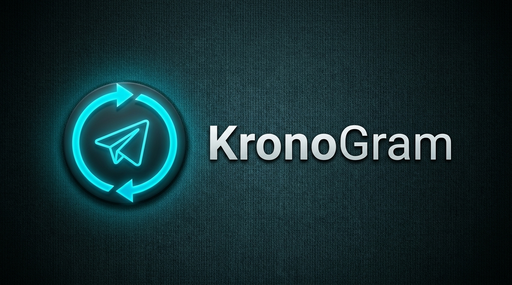

<p align="center">
  
</p>

<h1 align="center">KronoGram</h1>

<p align="center">
  <strong>A more private, customizable, and comfortable Telegram client for Android</strong>
</p>

<p align="center">
  <a href="README.md">🇪🇸 Español</a> &nbsp;·&nbsp; <strong>🇬🇧 English</strong>
</p>

<p align="center">
  
  
  
  
</p>

---

## What is KronoGram?

**KronoGram** is an Android messaging client built on the official **Telegram** source code. It preserves all the speed, stability, and compatibility of Telegram while adding a comprehensive suite of features designed for **advanced privacy, a locked hidden vault, visual customization, offline voice transcription, cloud backups, and everyday productivity**.

---

## Table of Contents

- [Privacy, Ghost Mode & Hidden Vault](#privacy-ghost-mode--hidden-vault)
- [Zero Telemetry, Ad-Free & Privacy-Friendly Maps](#zero-telemetry-ad-free--privacy-friendly-maps)
- [Design, Appearance & Customization](#design-appearance--customization)
- [Chats, Folders, Gestures & Storage](#chats-folders-gestures--storage)
- [Offline Voice Transcription & Free Translation](#offline-voice-transcription--free-translation)
- [Cloud & Local Backup](#cloud--local-backup)
- [Reliable Notifications & Push Diagnostics](#reliable-notifications--push-diagnostics)
- [Building from Source](#building-from-source)
- [Credits & Acknowledgements](#credits--acknowledgements)
- [License](#license)

---

## Key Features

### Privacy, Ghost Mode & Hidden Vault

- **Full Ghost Mode:** Toggle everything in one tap (automatically saving and restoring your individual preferences when turned off) or configure each option independently:
  - **Don't mark messages as read** (with local read tracking; also skips open confirmation on view-once media).
  - **Don't mark stories as viewed.**
  - **Hide "typing..." status.**
  - **Hide "online" status.**
- **Hidden Chats & Folders Vault:**
  - Hide individual chats (via long-press or multi-select) and entire folders (by long-pressing a folder tab).
  - **Discreet quick access:** Long-press the **"KronoGram"** title in the top chat bar or open it from *KronoGram Settings*.
  - **Multi-layer protection:** Lock the vault with **Biometrics** (fingerprint/face), a **Numeric PIN** (4–8 digits stored with salted SHA-256), a **Custom Password**, or **Biometrics + PIN/Password**.
  - **Screenshot & Recents protection (`FLAG_SECURE`):** Automatically blocks screenshots and hides previews in the recent apps switcher while viewing the vault or hidden chats.
  - **Full control:** Mute notifications and previews for hidden chats/folders, hide chats belonging to hidden folders everywhere (including "All Chats" and search), and auto-lock the vault when moving the app to the background.
- **Anti-delete messages:** Preserves messages deleted by others locally on your device with a "deleted" indicator, with an option to exclude channels (enabled by default).
- **Unlimited View-Once media:** Reopen self-destructing photos, videos, voice messages, and video messages as many times as you want, plus an optional toggle to allow screenshots and saving to your gallery.
- **Bypass restricted content:** Allows screenshots, screen recording, copying text, saving files, and forwarding in restricted channels, chats, stories, and secret chats.
- **On-screen discretion & extra controls:**
  - Hide your phone number in Settings, Navigation Drawer, and Profile.
  - Hide chat names and avatars in the main chat list for extra privacy in public.
  - Block starting or accepting Secret Chats.

---

### Zero Telemetry, Ad-Free & Privacy-Friendly Maps

- **One-tap *Zero Telemetry* master switch** or granular per-option control:
  - **Block internal Telegram telemetry:** Stops `appLog`, device stats, and install referrer reporting.
  - **Disable Firebase Analytics:** Disables analytics and ad ID collection at runtime.
  - **Block ads & sponsored metrics:** Hides sponsored messages and videos in channels and prevents impression/click tracking.
  - **Strip URL trackers:** Automatically removes tracking query parameters (`utm_*`, `fbclid`, `gclid`, `igshid`, `si`, etc.) before opening links.
  - **Disable Google Push (FCM):** Opt out of Firebase Cloud Messaging and rely on Telegram's own background notification service.
- **Built-in OpenStreetMap provider:** Native map view powered by OpenStreetMap tiles (`tile.openstreetmap.org`) with dark-mode styling, markers, and location sharing without requiring a Google Maps API key.

---

### Design, Appearance & Customization

- **Monet (Material You) Themes:** Choose between *Monet Light*, *Monet Dark*, and *Monet AMOLED* (pure black for OLED displays). On Android 12+, themes adapt dynamically to your system tonal palettes (`system_accent` / `system_neutral`), with a harmonious slate-blue fallback on earlier Android versions and avatar color harmonization.
- **Three Visual Interface Styles:** Instantly switch the overall UI look between:
  - **Material You (Material 3 / Monet):** Modern rounded cards and Material 3 switches.
  - **iOS Style:** Centered headers, pills, and Cupertino-inspired toggles.
  - **Classic Style:** Clean, flat, borderless lists.
- **Disable title marquee:** Stops continuous horizontal scrolling on long titles in headers and the media viewer.
- **Custom Adaptive KronoGram Icons:** Choose from multiple exclusive app icons (*Default*, *Vintage*, *Aqua*, *Premium*, *Turbo*, and *Nox*) with full adaptive and monochrome themed icon support.

---

### Chats, Folders, Gestures & Storage

- **Fully customizable folder tabs:**
  - **Display mode:** *Text only*, *Icon & text*, or *Icon only* (with a built-in custom folder icon picker).
  - **Five indicator styles:** *Default*, *Rounded*, *Pill*, *Bottom underline (VKUI)*, or *Text only (no indicator)*.
  - Subtle active-tab stroke outline, option to hide unread counters on tabs, and option to display the active folder name in the top header.
  - **Infinite folder scroll:** Loops smoothly between the first and last folder instead of jumping to Contacts (or disable horizontal swipe between folders altogether).
  - **Local "Favorites" (⭐) folder** and an option to hide the "All Chats" tab whenever custom folders exist.
  - Quickly add or remove chats from any folder by long-pressing a chat in the list.
- **Chat gestures & productivity enhancements:**
  - **Customizable message swipe action:** *Reply*, *Edit (if own) / Reply*, *Save to Saved Messages*, *Translate*, *Forward*, *Copy text*, or *Disabled*.
  - **Swipe to edit own messages:** Swipe left on your own sent messages to edit them immediately.
  - **Check "Delete for everyone" by default** when deleting messages.
  - **Exact timestamps with seconds** on message bubbles.
  - **Unlimited local pinned chats.**
  - **Quick "Go to message" button in search** for files, links, and audio results.
  - **Context menu on long-press in search & shared media** for instant *Go to message*, *Select*, and *Forward* actions.
  - **Disable pull-to-next-channel / topic** when scrolling to the bottom.
  - **Spoiler Word Filter:** Automatically masks custom comma- or newline-separated words under Telegram spoilers (great for avoiding TV, movie, or sports spoilers).
- **Files & granular cache control:**
  - **Keep original filenames:** Saves documents with their original name instead of adding numeric prefixes.
  - **Per-message & per-album cache deletion:** Remove cached media for a specific message or album directly from the message context menu or media viewer, showing the exact space freed.
  - **One-tap cache cleaner:** Displays current cache size and clears temporary files without touching chats or your Downloads folder, plus a shortcut to Telegram's advanced Storage Usage manager.
- **Settings Search integration:** Every KronoGram setting can be found directly through Telegram's built-in Settings search bar.

---

### Offline Voice Transcription & Free Translation

- **Free Voice & Video-Message Transcription (No Premium, No API keys):**
  - Powered by **Vosk** and **Media3 FFmpeg/AudioDecoder**, running 100% locally on any Android version.
  - **Two modes:** *Automatic (Free Telegram → Local offline)* or *Always local offline (no servers)*.
  - **Built-in offline model manager (~31–48 MB per language):** Download or clear lightweight models for **8 languages** (*Spanish*, *English (US)*, *Portuguese*, *French*, *German*, *Italian*, *Russian*, and *Catalan*), plus automatic detection based on your app or system language.
- **Free Message & Full-Chat Translation:**
  - Unlock message, full-chat, and channel translation without Telegram Premium.
  - **4 selectable translation engines:** **Google Translate**, **Yandex Translate**, **Lingva Translate**, and official **Telegram**.

---

### Cloud & Local Backup

- **Telegram CloudStorage Backup (`@KronoGramCloudBot`):** Stores your settings in Telegram's native `CloudStorage` over MTProto (using chunked GZIP + Base64 encoding), with no third-party servers or hardcoded tokens.
- **Four sync modes:** *Automatic (on settings change, with 20-second smart debounce and offline retry)*, *Daily*, *Weekly*, and *Manual*.
- **Granular category selection (for both backup and restore):** Choose exactly what to include:
  - KronoGram settings (including custom folder icons).
  - Main Telegram settings.
  - Theme & appearance.
  - Telegram notifications.
  - Hidden Vault list *(unchecked by default for privacy)*.
- **Saved Messages & local `.kronogram` files:** Send backups directly to *Saved Messages* — tap any `.kronogram` file in a chat to restore immediately — or export/import locally via Android's Storage Access Framework (SAF).
- **Private & secure by design:** Never exports active login sessions, app passcodes, tokens, or your Hidden Vault PIN/password.
- **Safe defaults reset:** Reset only KronoGram settings back to defaults with an option to keep your Hidden Vault untouched.

---

### Reliable Notifications & Push Diagnostics

- **Persistent Foreground Service (OEM anti-kill):** Optional low-priority silent notification designed for devices with aggressive battery management (Xiaomi/HyperOS, Samsung, Huawei, Oppo…) so messages arrive reliably with the screen off.
- **Background MTProto TCP Connection:** Keeps push delivery active when Google Push (FCM) fails or is disabled.
- **Built-in Push Diagnostics Center:** Inspect Google Play Services, FCM status, FCM token and registration (with full technical details and quick copy), notification permission, battery optimization status (with direct shortcuts to system settings), anti-kill service status, and last received FCM push; also lets you **force FCM token re-registration** and trigger a **local test notification** in one tap.
- **Android Auto support:** Read and reply to messages from your car display via `MessagingStyle` notifications and the native Android Auto messaging app (`CarAppService`), play voice notes, and browse music from your chats while respecting app passcode lock and KronoGram's Hidden Vault.

---

## Building from Source

### Requirements
- **JDK:** Java 21
- **Android SDK:** API Level 36 (`compileSdk 36`, `targetSdk 36`, `minSdk 24`, `buildTools 36.0.0`)
- **Gradle:** 9.3.1 (bundled via `./gradlew`) · Android Gradle Plugin `9.1.1`
- **Application ID:** `com.rcuenca.kronogram`

### 1. Development Build (Debug)
Builds an installable `arm64-v8a` APK signed with the debug keystore:

```bash
./gradlew assembleDebug
```

Output path: `app/build/outputs/apk/debug/KronoGram-<version>-<code>-arm64-v8a.apk`.

### 2. Production Build (Release)
Build a release `arm64-v8a` APK signed with your own `.jks` or `.keystore` using environment variables:

```bash
KEYSTORE_PATH="/absolute/path/to/your-keystore.jks" \
STORE_PASSWORD="your_store_password" \
KEY_ALIAS="your_key_alias" \
KEY_PASSWORD="your_key_password" \
./gradlew assembleRelease
```

To generate an Android App Bundle (`.aab`) for Google Play (with ABI splits disabled for bundles):

```bash
KEYSTORE_PATH="/absolute/path/to/your-keystore.jks" \
STORE_PASSWORD="your_store_password" \
KEY_ALIAS="your_key_alias" \
KEY_PASSWORD="your_key_password" \
./gradlew bundleRelease
```

Generated artifacts can be found in:
- **APK:** `app/build/outputs/apk/release/`
- **AAB:** `app/build/outputs/bundle/release/`

*(If `KEY_ALIAS` is omitted while `KEYSTORE_PATH` is set, it defaults to `"upload"`. Running `assembleRelease` without `KEYSTORE_PATH` falls back to the bundled `debug.keystore`).*

---

## Credits & Acknowledgements

**KronoGram** wouldn't be possible without the vibrant open-source Telegram Android community. Special thanks to the following base projects, forks, and open-source libraries for their codebase, architecture, or feature and design inspiration:

### Official Base
- **[Telegram for Android](https://github.com/DrKLO/Telegram)** — Official open-source client on which KronoGram is built.

### Telegram Forks (Code, Architecture & Inspiration)
- **[Nekogram](https://github.com/Nekogram/Nekogram)** — Modular project foundation (Gradle setup, Media3, and LaTeX rendering), as well as inspiration for alternative translation providers and privacy/usability enhancements.
- **[AyuGram](https://github.com/AyuGram/AyuGram4A)** — Core inspiration for Ghost Mode, Anti-Delete message preservation, unlimited View-Once media, and restricted content bypass.
- **[exteraGram](https://github.com/exteraSquad/exteraGram)** — Inspiration for Monet (Material You) dynamic themes, folder tab indicator styles (rounded, pill, VKUI underline, icons), and modern UI refinements.
- **[Cherrygram](https://github.com/arsLan4k1390/Cherrygram)** — Inspiration for chat swipe gestures, folder customization, and search/media quality-of-life improvements.
- **[OctoGram](https://github.com/OctoGramApp/OctoGram)** — Inspiration for visual styles, settings organization, and backup/export concepts.
- **[OwlGram](https://github.com/OwlGramDev/OwlGram)** — Inspiration for Monet theming and UI/tab styling ideas.
- **[NekoX](https://github.com/NekoX-Dev/NekoX)** — Inspiration for advanced privacy controls, anti-telemetry toggles, and power-user options.
- **[Telegram FOSS](https://github.com/Telegram-FOSS-Team/Telegram-FOSS)** — Inspiration for privacy-first practices, optional non-FCM push operation, and replacing Google Maps with OpenStreetMap.
- **[Forkgram](https://github.com/Forkgram/TelegramAndroid)** — Inspiration for clean, practical everyday chat and file improvements.

### Open-Source Libraries & Services
- **[Vosk (Alpha Cephei)](https://alphacephei.com/vosk/)** — On-device offline speech recognition engine powering free voice transcription without servers.
- **[AndroidX Media3](https://github.com/androidx/media)** — Audio decoding and media playback pipeline.
- **[OpenStreetMap](https://www.openstreetmap.org/)** — Free, open map tiles powering KronoGram's built-in privacy-friendly map provider.
- **[Lingva Translate](https://github.com/thedaviddelta/lingva-translate)** — Open-source privacy-respecting translation frontend.
- **[JLaTeXMath](https://github.com/opencollab/jlatexmath) & [Markwon](https://github.com/noties/Markwon)** — Mathematical formula and rich text rendering support.

---

## License

**KronoGram** is free software released under the **GNU General Public License v2.0 (GPLv2)**, in compliance with the official Telegram for Android source code. See [LICENSE](LICENSE) for full details.
