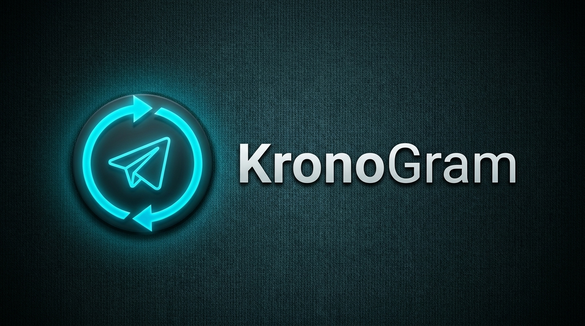

<p align="center">
  
</p>

<h1 align="center">KronoGram</h1>

<p align="center">
  <strong>Tu cliente de Telegram para Android más privado, personalizable y cómodo</strong>
</p>

<p align="center">
  
  
  
</p>

---

## ¿Qué es KronoGram?

**KronoGram** es una aplicación de mensajería para Android creada a partir del cliente oficial de **Telegram**. Conserva toda la velocidad, estabilidad y compatibilidad de siempre, pero añade un conjunto completo de funciones pensadas para darte **más privacidad, un diseño adaptable a tu gusto y herramientas prácticas para tus chats diarios**.

---

## Características principales

### Privacidad y Modo Fantasma
- **Modo Fantasma completo:** Lee mensajes y mira historias sin enviar confirmación de lectura, y oculta cuándo estás «escribiendo...» o «en línea». Puedes activarlo todo con un solo botón o elegir cada opción por separado.
- **Guardar mensajes eliminados:** Conserva en tu dispositivo los mensajes que otras personas borren en chats privados o grupos, indicándolos como eliminados (con opción de excluir canales).
- **Multimedia de 1 sola vista sin límite:** Vuelve a abrir fotos, vídeos, notas de voz y videomensajes temporales todas las veces que necesites, con opción para permitir capturas de pantalla y guardarlos.
- **Discreción en pantalla:** Oculta tu número de teléfono en los menús y esconde nombres y fotos de perfil en tu lista principal de chats cuando estés acompañado.
- **Bloqueo de chats secretos:** Opción para impedir iniciar o aceptar chats secretos automáticamente.

### Sin anuncios ni rastreadores (Cero Telemetría)
- **Adiós a los anuncios:** Oculta los mensajes y vídeos patrocinados en canales.
- **Cero telemetría:** Desactiva el envío de estadísticas de uso y registros internos de actividad.
- **Enlaces limpios:** Elimina automáticamente los parámetros de seguimiento ocultos en los enlaces web antes de abrirlos.
- **Push opcional:** Posibilidad de desactivar el servicio de notificaciones de Google y usar el servicio propio en segundo plano.

### Diseño y Apariencia a tu medida
- **Temas Monet (Material You):** Elige entre *Monet Light*, *Monet Dark* y *Monet AMOLED* (negro puro ideal para ahorrar batería en pantallas OLED), con colores modernos y armónicos.
- **Tres estilos visuales de interfaz:** Cambia al instante el aspecto general de la aplicación entre:
  - **Material You:** Tarjetas modernas con bordes redondeados.
  - **Estilo iOS:** Cabeceras centradas e interruptores inspirados en Apple.
  - **Telegram X:** Diseño limpio, plano y minimalista.

### Chats, Carpetas y Productividad
- **Pestañas totalmente personalizables:** Elige mostrar solo nombre, solo icono o icono y nombre; cambia entre cinco estilos (*Predeterminado*, *Redondeado*, *Píldora*, *Subrayado* o *Solo texto*), añade un contorno a la pestaña activa, oculta los contadores de no leídos, muestra la carpeta actual en la barra superior, oculta la pestaña «Todos» o bloquea el cambio entre carpetas al deslizar.
- **Carpeta de «Favoritos» y chats anclados ilimitados:** Agrupa tus conversaciones clave en una carpeta local dedicada y fija todos los chats que quieras sin restricciones. También puedes añadir o quitar chats de cualquier carpeta manteniendo pulsado un chat en la lista.
- **Gesto personalizable al deslizar mensajes:** Decide qué hace el gesto de deslizar sobre un mensaje: *Responder*, *Editar si es tuyo*, *Guardar en Mensajes guardados*, *Traducir*, *Reenviar* o *Copiar texto*.
- **Opciones prácticas en cada conversación:**
  - Marca «Borrar para todos» por defecto al eliminar mensajes.
  - Muestra la hora exacta con segundos en los mensajes.
  - **Filtro de palabras bajo Spoiler:** Oculta automáticamente las palabras que elijas (ideal para evitar adelantos de series, películas o deportes).
- **Archivos y caché bajo control:** Guarda documentos conservando su nombre original y limpia la caché temporal con un botón directo sin perder tus chats ni tus descargas.

### Voz y Traducción sin barreras
- **Transcripción de voz gratuita:** Convierte mensajes de voz y videomensajes en texto directamente desde el chat sin necesidad de suscripción.
- **Múltiples motores de traducción:** Elige tu traductor favorito entre **Google Translate**, **DeepL**, **Yandex**, **Lingva** o el traductor oficial de **Telegram**.

### Notificaciones fiables y Diagnóstico
- **Protección anti-cierre:** Servicio persistente opcional pensado para teléfonos con ahorro de batería agresivo (Xiaomi, Samsung, Huawei, Oppo…) para que las notificaciones sigan llegando a tiempo con la pantalla apagada.
- **Centro de diagnóstico integrado:** Revisa en un vistazo permisos, batería, estado del servicio y envía una notificación de prueba con un toque para comprobar que todo funciona correctamente.

---

## Compilación

Si quieres compilar **KronoGram** por tu cuenta a partir del código fuente:

### Requisitos
- **JDK:** Java 21
- **Android SDK:** API Level 36 (`compileSdk 36`, `targetSdk 36`, `minSdk 23`)
- **Gradle:** 9.3.1 (incluido en el proyecto mediante `./gradlew`)

### 1. Versión de desarrollo (Debug)
Genera un APK listo para instalar firmado con el certificado de depuración:

```bash
./gradlew assembleDebug
```

El archivo resultante se guardará en `app/build/outputs/apk/debug/`.

### 2. Versión de producción (Release)
Puedes generar un APK o un Android App Bundle (`.aab`) firmado con tu propio certificado (`.jks` o `.keystore`) mediante variables de entorno:

```bash
KEYSTORE_PATH="/ruta/absoluta/a/tu-keystore.jks" \
STORE_PASSWORD="tu_store_password" \
KEY_ALIAS="tu_key_alias" \
KEY_PASSWORD="tu_key_password" \
./gradlew assembleRelease
```

Para generar el paquete de Google Play (`.aab`):

```bash
KEYSTORE_PATH="/ruta/absoluta/a/tu-keystore.jks" \
STORE_PASSWORD="tu_store_password" \
KEY_ALIAS="tu_key_alias" \
KEY_PASSWORD="tu_key_password" \
./gradlew bundleRelease
```

Los archivos generados estarán en:
- **APK:** `app/build/outputs/apk/release/`
- **AAB:** `app/build/outputs/bundle/release/`

*(Si ejecutas `assembleRelease` sin definir `KEYSTORE_PATH`, se utilizará el keystore de depuración incluido como respaldo).*

---

## Licencia

**KronoGram** es software libre publicado bajo la licencia **GNU General Public License v2.0 (GPLv2)**, en conformidad con el código fuente oficial de Telegram para Android. Consulta el archivo [LICENSE](LICENSE) para más información.
